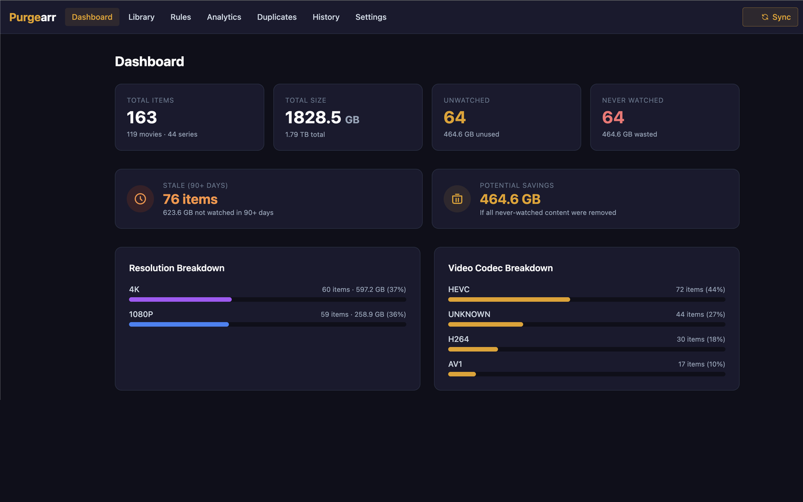
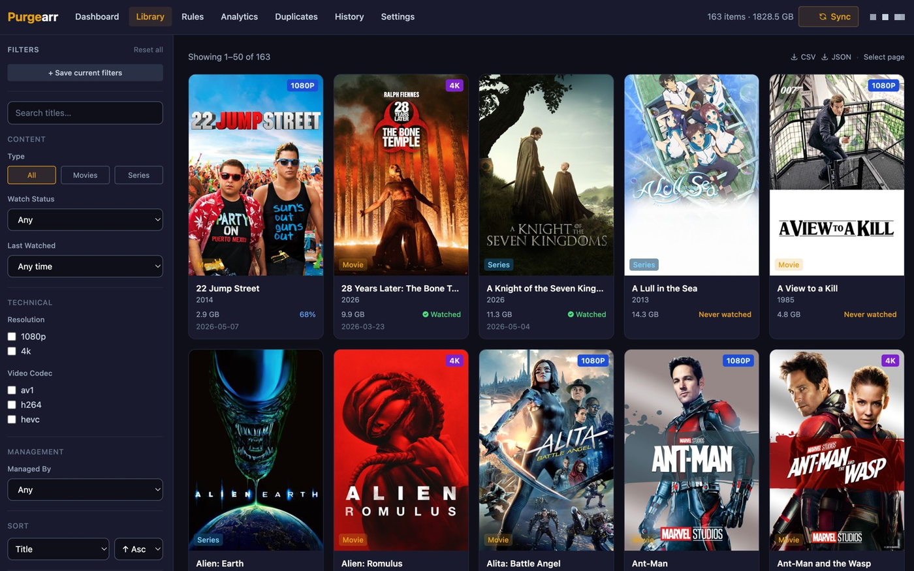
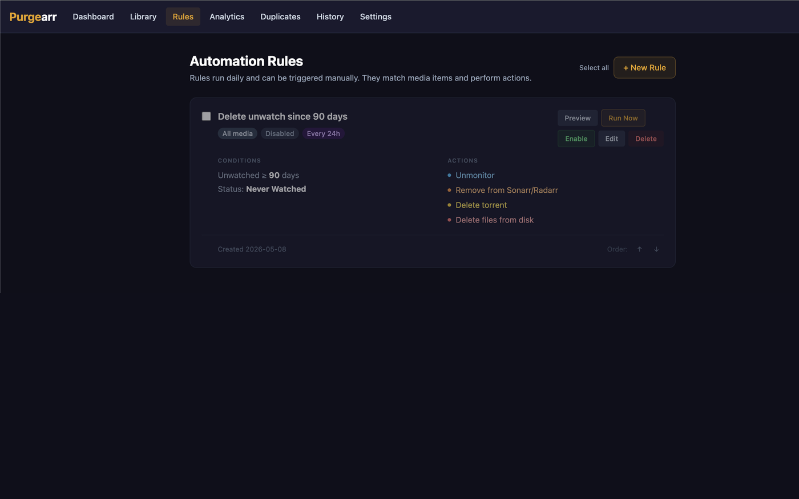
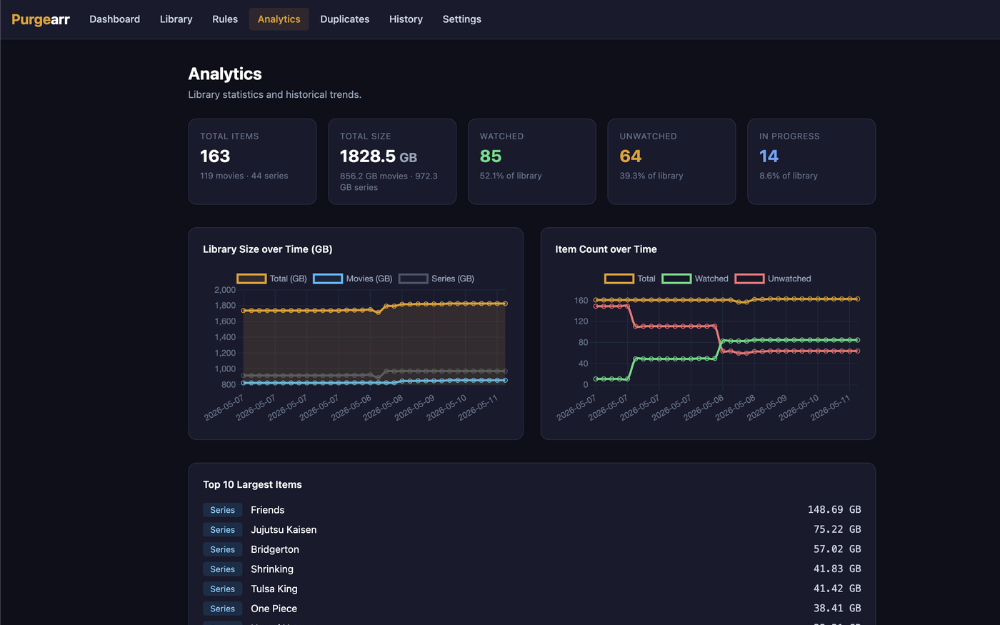
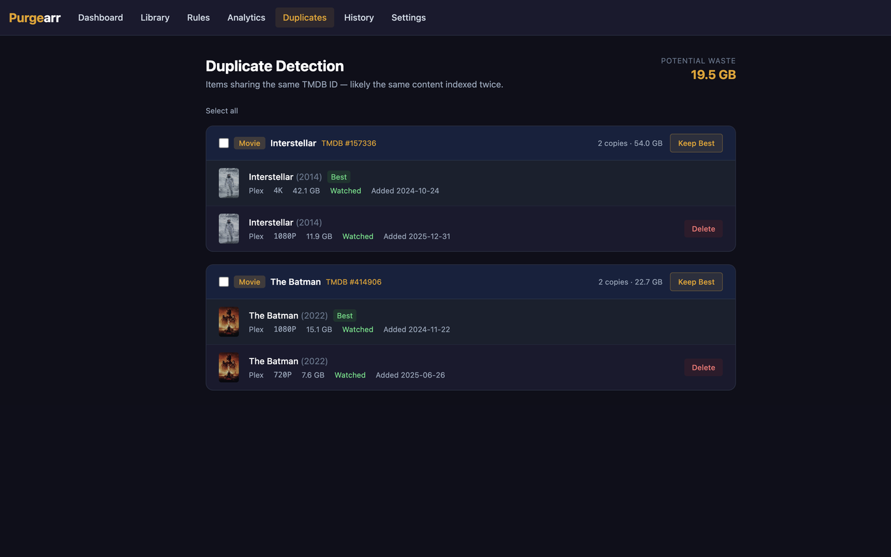
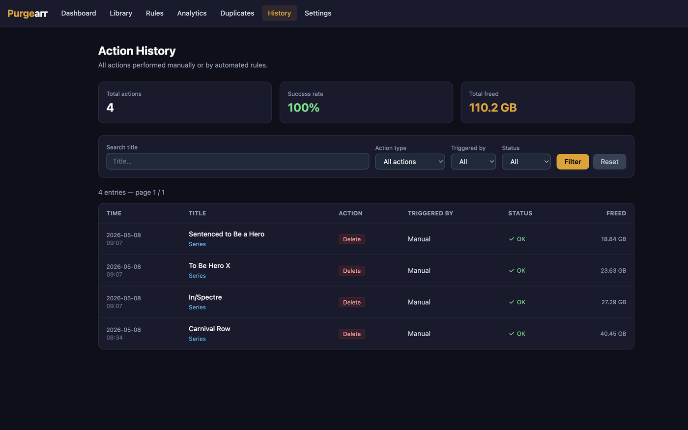

<div align="center">

# <span style="color:#e5a00d">Purge</span>arr

**Media library cleanup automation for self-hosted homelabs.**

Automatically identify and remove stale, unwatched, or duplicate content from Plex/Jellyfin —  
with full Sonarr/Radarr/qBittorrent integration and a clean web UI.

[](https://gitlab.com/grumpypillow/purgearr/-/pipelines)
[](https://gitlab.com/grumpypillow/purgearr/container_registry)
[](LICENSE)

<sub>Developed on [GitLab](https://gitlab.com/grumpypillow/purgearr), where the CI, the
container registry and the releases live. A single-commit mirror of the current source is
published on [GitHub](https://github.com/Pasouvenla/purgearr).</sub>

<br/>



</div>

---

## Features

- **Library sync** — indexes Plex or Jellyfin, cross-references Sonarr/Radarr by TVDB/TMDB/IMDb id (falling back to title) so items still match when the two sides name them differently
- **Automation rules** — configurable conditions (days unwatched, size, resolution, genres, tags) with per-rule schedules; actions include unmonitor, remove from arr, delete torrent, delete files, delete via media server
- **Media server deletion** — lets Plex/Jellyfin delete the files itself. The only route for items no arr tool manages, and it needs no filesystem access from the host running purgearr ([details](#media-server-deletion))
- **Duplicate detection** — groups items by TMDB ID, one-click "keep best resolution" cleanup
- **Bulk operations** — select all + bulk enable/disable/delete on rules, library items, and duplicate groups
- **Analytics** — library size/count trends over time via historical snapshots
- **Action history** — full audit log with filtering by action, trigger, status, and title search
- **Outgoing webhooks** — signed HMAC-SHA256 POSTs on rule execution, deletion, and sync
- **Notifications** — ntfy, Gotify, Discord webhook, Apprise API
- **Tautulli integration** — enriched watch history for Plex
- **Seerr integration** — delete matching Overseerr/Jellyseerr requests on purge
- **Responsive** — works across desktop, tablet, and mobile

---

## Screenshots

<table>
  <tr>
    <td align="center"><b>Library</b></td>
    <td align="center"><b>Automation Rules</b></td>
  </tr>
  <tr>
    <td></td>
    <td></td>
  </tr>
  <tr>
    <td align="center"><b>Analytics</b></td>
    <td align="center"><b>Duplicate Detection</b></td>
  </tr>
  <tr>
    <td></td>
    <td></td>
  </tr>
  <tr>
    <td align="center" colspan="2"><b>Action History</b></td>
  </tr>
  <tr>
    <td colspan="2" align="center"></td>
  </tr>
</table>

---

## Quick Start

### Docker run

```bash
docker run -d \
  --name purgearr \
  -p 8765:8765 \
  -v /opt/purgearr/data:/data \
  -e SECRET_KEY=$(openssl rand -hex 32) \
  registry.gitlab.com/grumpypillow/purgearr:latest
```

### Docker Compose

```yaml
services:
  purgearr:
    image: registry.gitlab.com/grumpypillow/purgearr:latest
    container_name: purgearr
    ports:
      - "8765:8765"
    volumes:
      - /opt/purgearr/data:/data
    environment:
      - SECRET_KEY=${SECRET_KEY}   # required — generate with: openssl rand -hex 32
      - TZ=Europe/Paris            # optional
    restart: unless-stopped
```

Navigate to `http://localhost:8765` — first run prompts account creation.

> **Note:** `SECRET_KEY` is required. If omitted, a random key is generated at startup and sessions will not survive container restarts.

---

## Configuration

All settings are managed in the web UI under **Settings**:

| Section | Keys |
|---|---|
| Media Server | Plex or Jellyfin URL + token |
| Sonarr / Radarr | URL + API key |
| qBittorrent | [QUI](https://github.com/autobrr/qui) URL + API key + instance ID |
| TMDB | API key (v3) + country for streaming providers |
| Seerr | URL + API key (Overseerr or Jellyseerr) |
| Tautulli | URL + API key |
| Notifications | ntfy / Gotify / Discord / Apprise |
| Webhooks | URL + optional HMAC secret |
| Auto-sync | Interval (disabled / 1h / 6h / 12h / 24h) |

Settings can be exported and imported as JSON from the Settings page.

> **qBittorrent note:** The qBittorrent integration requires [QUI](https://github.com/autobrr/qui), a modern alternative Web UI for qBittorrent that exposes an API key. The native qBittorrent Web UI uses username/password authentication and is not supported.

---

## Automation Rules

Rules evaluate all library items on a schedule (or on demand) and execute configured actions on matching items.

**Conditions:**
- Days since last watch (minimum 1)
- Watch status: any / unwatched / never watched
- Media type: movie / series / both
- File size range (GB)
- Resolution (1080p, 4k, …)
- Genres (comma-separated)
- Arr tags (comma-separated)

**Actions (combinable):**
- Unmonitor in Sonarr / Radarr
- Remove from Sonarr / Radarr
- Delete torrent from qBittorrent
- Delete files from disk
- Delete via media server (see below)

**Schedules:** per-rule intervals (6h / 12h / 24h / weekly) in addition to the global daily run.

An action that cannot be attempted is reported as a failure, never as a success. If an
item has no Sonarr/Radarr match, the deletion fails with an explicit reason and the item
stays in the library rather than silently disappearing from purgearr while the arr tool
still holds it.

---

## Media server deletion

Plex and Jellyfin can delete a library item and its files themselves. Purgearr drives that
over their APIs, so it never touches the filesystem and needs no access to your media
mounts — useful when purgearr runs in a container and the library lives on a NAS.

Its main use is items **no arr tool manages**: those have no Sonarr/Radarr id, so every
other deletion target skips them and they can otherwise only be cleaned up by hand.

Enable deletion on the server first, or the request is refused:

| Server | Requirement |
|---|---|
| Plex | Settings → Library → **Allow media deletion** |
| Jellyfin | User policy → **Allow media deletion** (globally or per folder) |

Purgearr reads that setting before deleting and tells you when it is off, because both
servers otherwise answer with an error that looks like a bad token.

> **The server needs write access to the media.** Plex answers a generic `400 Bad Request`
> when its own process cannot remove the files — typically a read-only mount or media owned
> by another user. Mounting your library read-only in the media server is good practice, but
> it does make this action unavailable: use the arr deletion instead.

> **Freed space is an upper bound.** Arr tools import by hardlink, so deleting the library
> copy only drops one link — a still-seeding torrent keeps the data on disk. Purgearr never
> stats the filesystem, so it reports the item size rather than measuring what was reclaimed.

---

## Webhook Payload

Events: `rule_executed`, `items_deleted`, `sync_completed`, `test`

```json
{
  "event": "rule_executed",
  "timestamp": 1714000000,
  "rule_id": 1,
  "rule_name": "Delete unwatched movies",
  "matched": 5,
  "deleted": 5,
  "freed_gb": 23.4
}
```

If a secret is configured, requests include `X-Purgearr-Signature: sha256=<hmac>`.

---

## Building from Source

```bash
git clone https://gitlab.com/grumpypillow/purgearr
cd purgearr
python -m venv .venv && source .venv/bin/activate
pip install -r requirements.txt
DATABASE_URL=sqlite:///./data/purgearr.db SECRET_KEY=dev-key uvicorn app.main:app --reload --port 8765
```

---

## FAQ

**How long does a sync take?**  
A few seconds for a small library, a few minutes for several thousand items. It only reads your media server API and does not affect playback performance.

**How often should I sync?**  
Once a day is enough for most setups. You can configure auto-sync intervals from 1h to 24h in Settings.

**Why are some items missing a watch status?**  
Plex and Jellyfin only report watch status for the account whose token is configured. Other users on the same server are not tracked.

**Does Purgearr track all Plex users or just the main account?**  
Only the account whose token is set in Settings. For richer Plex history, connect Tautulli.

**My posters are not showing up.**  
A TMDB API key is required for poster fetching. Add it under Settings → TMDB.

**Do rules run automatically or do I need to trigger them manually?**  
Both — rules run automatically on their configured schedule, and can also be triggered manually with the "Run Now" button.

**What happens if Sonarr/Radarr is unreachable when a rule runs?**  
The action fails gracefully and is logged in History. No files are touched.

**Can I preview what a rule would do before running it?**  
Yes — every rule has a Preview button that shows matching items without performing any action.

**Where is Purgearr's data stored?**  
Everything is stored in a SQLite database in the `/data` volume. Back up that folder to preserve your settings, rules, and history.

**Does Purgearr support multiple Plex/Jellyfin servers?**  
No, one media server can be configured at a time.

---

## Security Notes

- All settings (API keys, tokens) are stored in the SQLite database — ensure your data volume is not world-readable.
- Webhook and notification URLs are user-configured and will receive outbound HTTP requests from the container. For self-hosted setups this is expected behavior.
- Authentication uses JWT tokens (PyJWT, HS256) in HttpOnly cookies with SameSite=lax. The
  accepted algorithm is an allow-list, so a token cannot name its own and downgrade
  verification.
- Passwords are hashed with bcrypt.
- Deletion is always delegated to the Sonarr/Radarr, qBittorrent, Plex and Jellyfin APIs.
  Purgearr performs no filesystem operation of its own and needs no access to your media.

> This project was developed with the help of [Claude](https://claude.ai) (Anthropic). The codebase has gone through security, logic, and code consistency reviews and has a unit and integration test suite covering the deletion paths, arr matching, auth and
> connectors, but not exhaustive coverage or a professional security audit. It runs in a real homelab production environment. Use it knowing what it is — contributions, feedback, and fixes are welcome.

---

## License

MIT — see [LICENSE](LICENSE)
